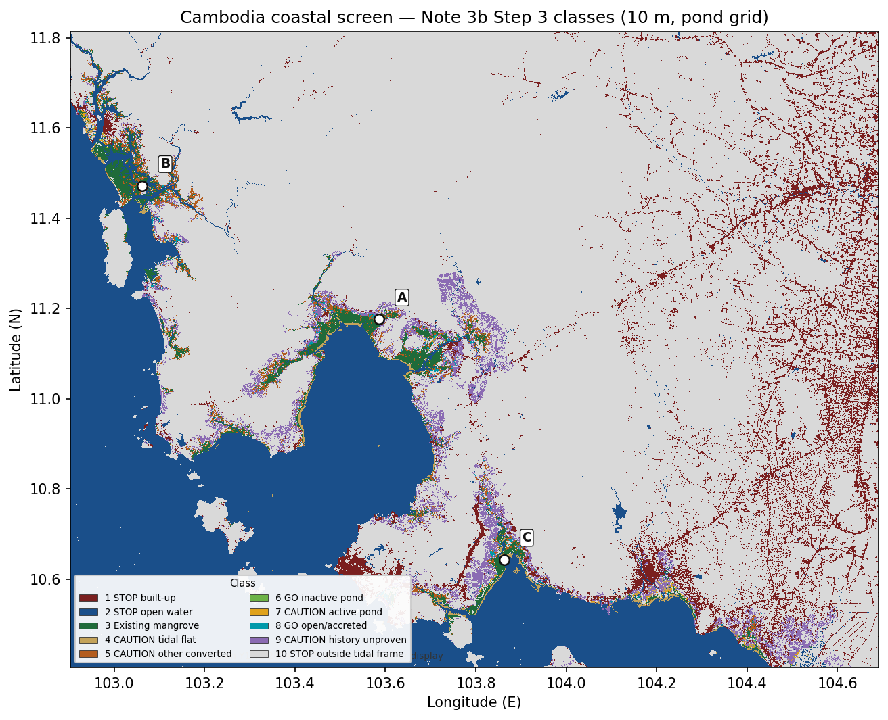
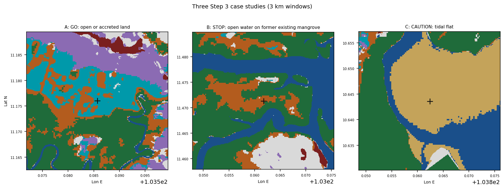
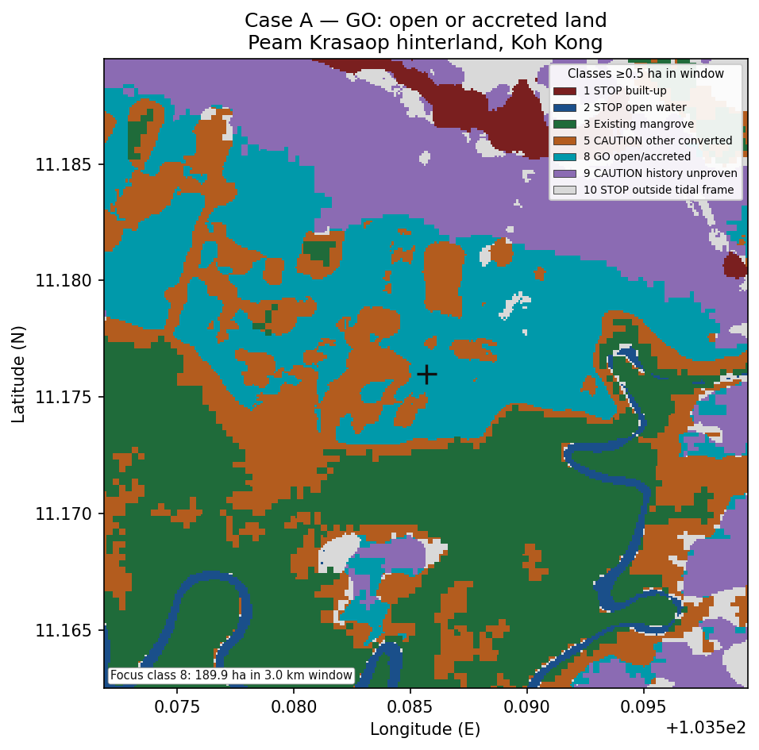
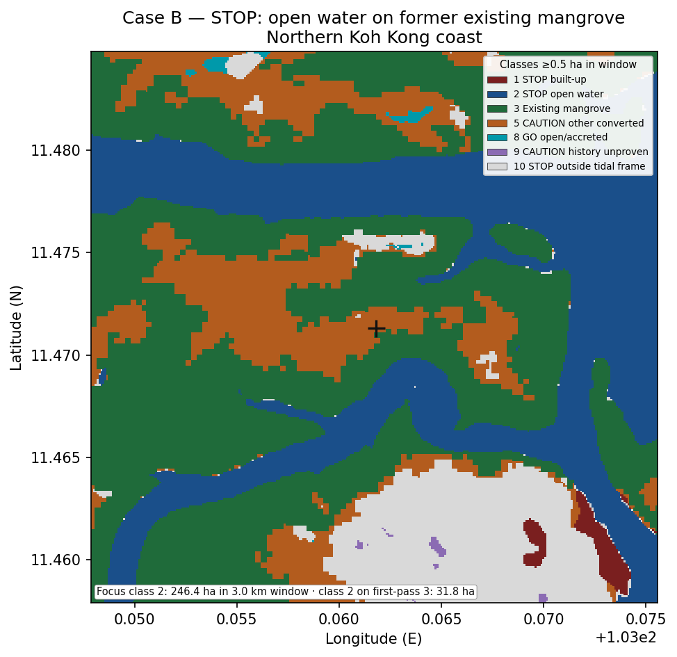
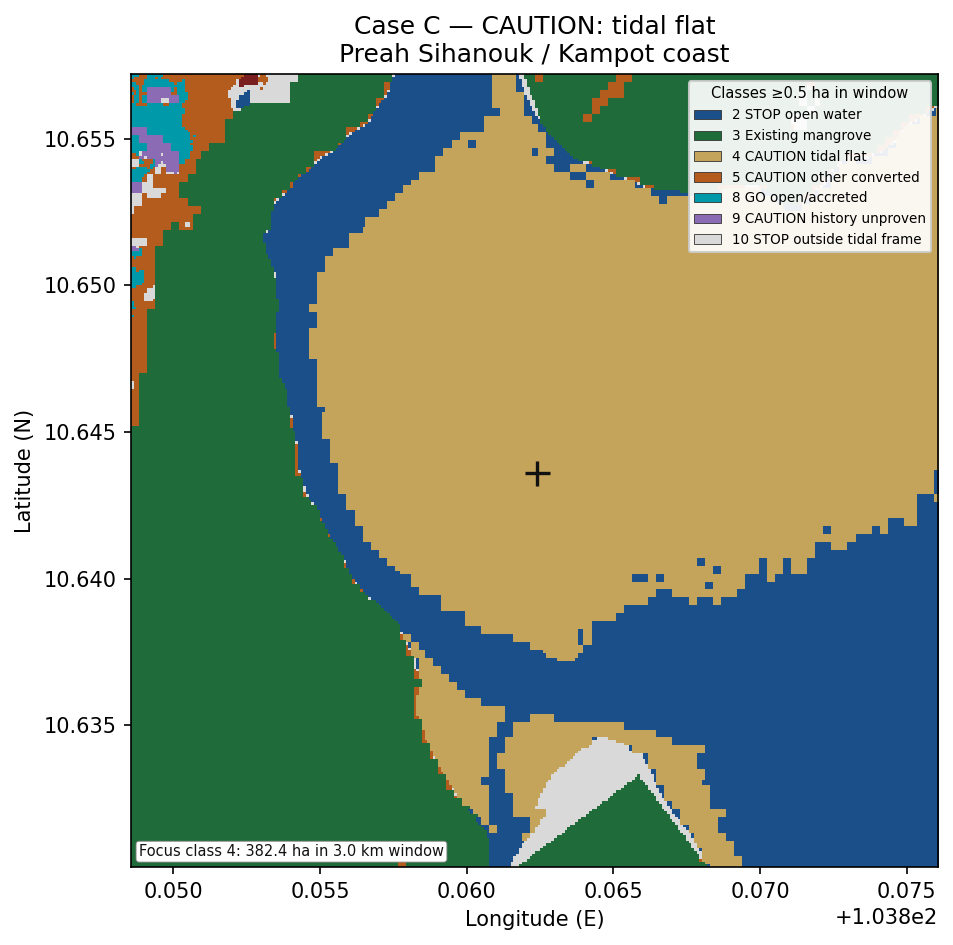

# Module — Restoration-potential screen

Prerequisites: [01-overview.md](01-overview.md); full rules in Note 3b. Status: [../README.md](../README.md).

Four-province coastal mangrove screen (Koh Kong, Preah Sihanouk, Kampot, Kep) at a 10 m analysis grid, built from open and restricted-licence (FLAG) data, with a restricted seagrass analogue. It is a **land-cover and permit eligibility filter** and a **proxy** for restoration potential: it does not test salinity, sediment supply, tenure willingness or carbon outcome. Method of record: [../outputs/03b-restoration-potential-screen-method.md](../outputs/03b-restoration-potential-screen-method.md).

This module is also the start of the **user guide** for reading the class map. Method numbers stay in Note 3b; build steps stay in [05-build-pipeline.md](05-build-pipeline.md). What follows is how to interpret a cell once the map is open.

## What it produces

- Class raster (ten classes: GO / CAUTION / STOP as **physical / land-cover suitability**, not legal clearance or tenure). Current file: [../inputs/screen-layers/L_class_10m/class_step3.tif](../inputs/screen-layers/L_class_10m/class_step3.tif). No class implies planting permission.
- Five flags (attach without changing class): permit gate; STOP (legal); project overlap; elevation check; small (under 100 ha contiguous). Elevation-check is on disk; permit / STOP (legal) / project-overlap are not yet burned into the class codes.
- Class areas and loss-year structure. **SEEA EA extent inputs (proposal):** class 3 (opening mangrove stock) and historic-loss / conversion readings called out in Note 3b §1.1. GO / CAUTION / STOP partitions are **not** ecosystem extent and must not be added to stock. A SEEA or ocean-accounts table is a **separate derivation**, not a by-product of the class raster. The screen itself is **not** a compiled account.

Extent: Koh Kong, Preah Sihanouk, Kampot, Kep; land under ~10 m elevation inside the habitat mask; sea to ~10 m depth for the seagrass analogue only. Minimum mapping unit 0.5 ha (applied in Step 1 H/C; Step 3 does not re-sieve).

## How to read the map

1. Open the class raster (or the overview PNG below). Colour is the **first matching** Note 3b rule, not a soft blend of layers.
2. Ask what the cell was historically (`H` = mangrove in the 1996 baseline or three consecutive years from 1996) and what it is now (Dynamic World over calendar 2024 and 2025, plus pond and flat layers).
3. Treat GO as "worth a field look" (physical suitability only; legal status unverified), CAUTION as "needs a named check before planting or claiming restoration", and STOP as "do not treat as a restoration site on this screen". Never read GO as MoE or CI zoning approval.
4. Read flags next to the class. A GO cell can still fail the elevation check or sit inside a core zone once those overlays are applied.
5. Do not treat class 10 (outside the tidal frame) as a surveyed finding. On the present pond-grid rectangle it is the residual: everything that matched no earlier rule, including inland province.

Four-province overview with the three worked examples marked A–C:

Hectare tables and zoom figures for the same sites: [../inputs/screen-layers/L_class_10m/visualizations/step3-case-studies.md](../inputs/screen-layers/L_class_10m/visualizations/step3-case-studies.md). Full screen QA (four-province extent): [../inputs/screen-layers/L_class_10m/class_step3_qa.md](../inputs/screen-layers/L_class_10m/class_step3_qa.md).

## Class order (summary)

Full rules and anchors are in Note 3b §4. Order of first match:

1. STOP: built-up  
2. STOP: open water  
3. Existing mangrove: conserve  
4. CAUTION: tidal flat  
5. CAUTION: other converted  
6. GO: inactive pond  
7. CAUTION: active pond  
8. GO: open or accreted land  
9. CAUTION: history unproven  
10. STOP: outside tidal frame  

Classes 3, 5 (salt only), 6 and 7 were assigned on a first pass from mangrove and pond layers. Classes 1 and 2 may replace those where they match. Class 4 does not replace them; overlap is counted in the QA and left as the earlier class.

## Worked examples (user guide)

Three sites, chosen because each answers a different question a reader will ask of the map. Windows are 3 km across. Strip view:

### Case A — Why is this GO?

**Place.** Peam Krasaop hinterland, Koh Kong (103.5857 E, 11.1760 N).  
**Class in focus.** 8 GO: open or accreted land (190 ha in the window).

**Narrative.** The window sits behind the Peam Krasaop mangrove front. Existing mangrove (class 3) still holds the wetter and more canalised ground. Inland of that fringe, large teal patches are class 8: the cell was historic mangrove, and Dynamic World now calls it bare, grass or shrub rather than trees, crops, water or built-up. Orange patches are class 5 (mostly trees outside current mangrove), and purple is class 9 (inside the habitat mask without a proven historic record under the H rule).

**Rationale.** Note 3b follows the open and accreted classes used in Indonesian restoration screening: where mangrove history is established and the cover is open, the site is a restoration candidate, not a conserve site and not a pond. The map therefore marks GO so Phase 1 scoping can put eyes on it. It is not yet a project. Before any planting claim, run the elevation-check flag (L12 vs L13) and the permit overlays; class 8 next to class 5 or 9 in the same window is a reminder that neighbouring cells failed a different test.

### Case B — Why did conserve become STOP?

**Place.** Northern Koh Kong coast (103.0618 E, 11.4713 N).  
**Class in focus.** 2 STOP: open water (246 ha in the window), including 32 ha that were first-pass existing mangrove (1,144 ha of that override across the screen extent).

**Narrative.** The first-pass map labelled much of this estuary as class 3 (current mangrove, conserve). After L8–L11, branching channels that Dynamic World sees as water in at least 90 percent of 2024–2025 observations flip to class 2, provided they are not a Murray tidal flat and not inside the Step 2 pond mask. Remaining green is mangrove that did not meet that water test. Brown is other converted use on historic mangrove.

**Rationale.** The open-water STOP exists so the screen does not propose restoration in permanent water. Because class 2 sits above class 3 in the rule order, a cell that is both "current mangrove in GMW" and "almost always water in Dynamic World" becomes STOP, not conserve. That is a deliberate product choice and a known tension: optical mangrove products and land-cover time series disagree on channel margins. Use Case B when explaining overrides of the first pass. Do not delete the screen-wide 1,144 ha from the conserve story without checking imagery; do not leave it as GO.

### Case C — Why is a bare coast only CAUTION?

**Place.** Preah Sihanouk / Kampot coast (103.8624 E, 10.6436 N).  
**Class in focus.** 4 CAUTION: tidal flat (382 ha in the window).

**Narrative.** A broad tan apron sits seaward of a green mangrove edge and beside deep blue open water. Murray Global Intertidal Change (latest epoch 2014–2016) marks those cells as tidal flat; Dynamic World now reads bare or water. The screen therefore refuses a GO label even though the surface looks "open" in the same sense as Case A.

**Rationale.** Global Mangrove Alliance tidal-frame guidance and Note 3b agree that mudflats are not planting ground: hydrology and natural recruitment come first. Class 4 is CAUTION so a reader pauses for that check instead of counting the hectares as accreted land. Class 8 in Case A required historic mangrove *and* open cover *without* the flat label; Case C fails that path at the flat rule, which sits higher than class 8. If a later hydrology study clears a parcel, that is a project decision outside this screen, not a silent reclass to GO.

## What the three cases teach together

| Question | Case | Product answer |
| --- | --- | --- |
| Where might restoration be worth scoping? | A | Class 8 (and, elsewhere, class 6 inactive ponds) |
| When does the map overturn "existing mangrove"? | B | Class 2 above class 3 when water frequency is extreme |
| When is open coast not GO? | C | Class 4 flats stay CAUTION |

Built-up STOP (class 1) is not one of the three worked sites. It is the Dynamic World modal call; most of its screen-wide area is not corroborated by WorldCover class 50 or a GHS-BUILT-S 2025 fraction of 50 percent. Disagreement is stored on `built_disagree.tif` and does not change the class. Read that flag before treating class 1 as settled urban fabric.

## Data layout

| Path | Contents |
| --- | --- |
| [../inputs/screen-layers/](../inputs/screen-layers/) | Staged and derived layers (Note 3b IDs **L1–L21**; see [04-data-and-licences.md](04-data-and-licences.md) for staged vs GEE-only), ponds, class rasters, QA sidecars |
| [../inputs/screen-layers/L_class_10m/](../inputs/screen-layers/L_class_10m/) | `class_step3.tif`, QA, built-up disagreement flag |
| [../inputs/screen-layers/L_class_10m/visualizations/](../inputs/screen-layers/L_class_10m/visualizations/) | Overview and case-study PNGs (figures for this guide) |
| [../intermediate/screen-build/](../intermediate/screen-build/) | Fetch/process scripts, phase-0 registers, prompts, session lock |

Layer catalogue and licence flags: [04-data-and-licences.md](04-data-and-licences.md). Scripts and step order: [05-build-pipeline.md](05-build-pipeline.md).

## Build state

Do not restate status here. Use [../README.md](../README.md) and [../intermediate/screen-build/SESSION-LOCK.md](../intermediate/screen-build/SESSION-LOCK.md).

## Release constraints

Several inputs are FLAG (non-commercial, no redistribute, or permission required). Derivatives inherit FLAG restrictions. Do not publish a combined product, share commercially, or push FLAG layers to a public remote without clearing [04-data-and-licences.md](04-data-and-licences.md). Prefer publishing method + open-only derivatives, or an INTERNAL-only package. Overview and case PNGs in `visualizations/` stay INTERNAL until a release decision clears the licence-by-use path (research vs CI relay vs grant vs credit).
