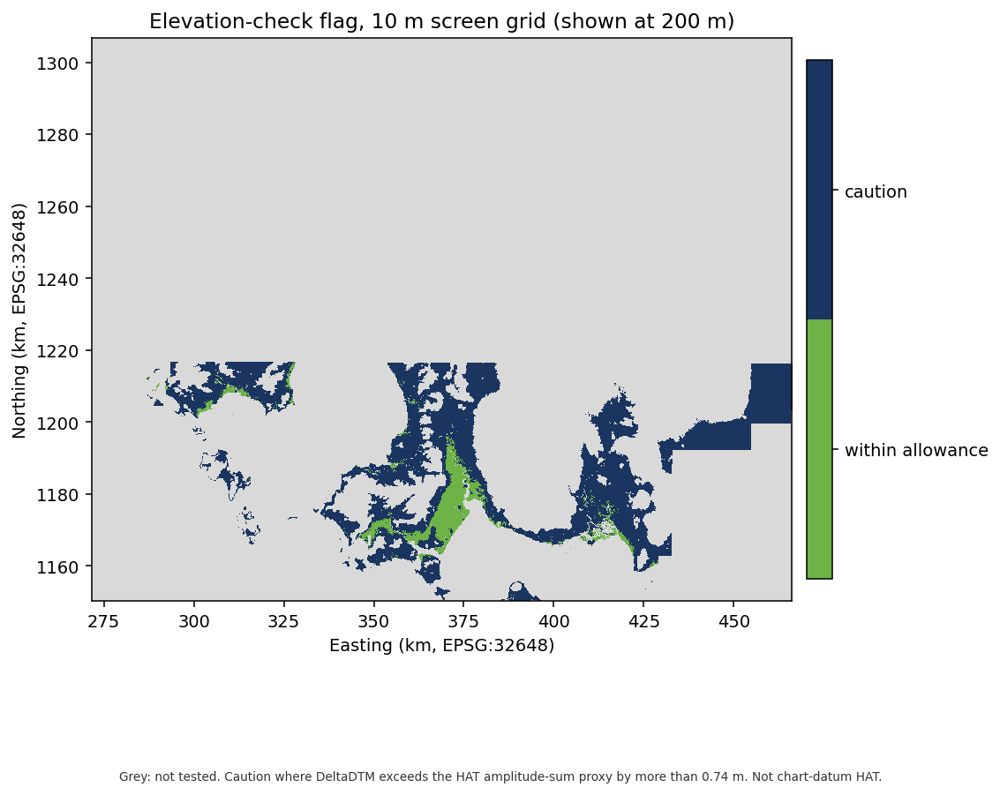

# L12 vs L13 elevation-check flag

**Status.** Note 3b elevation check on the 10 m screen grid. The first-pass class raster is unchanged. Where class 6 (GO: inactive pond) carries flag 1, read go as caution. No new class code.

## Rule

Flag a tested cell where `elev_m > hat_proxy_m + E_L12`.

- `E_L12` = **0.74 m**. Pronk et al. 2024, *Scientific Data* 11:273, Table 6 overall RMSE of DeltaDTM against airborne lidar (bias 0.01 m, MAE 0.45 m, RMSE 0.74 m). The same paper treats that RMSE as the vertical uncertainty for sea-level increments. DOI: [10.1038/s41597-024-03091-9](https://doi.org/10.1038/s41597-024-03091-9).
- Staged L12 is **DeltaDTM v1.1** (int16 decimetres, nodata -32768, divided by 10). The 4TU v1.1 record (12 Dec 2024) quotes an overall MAE of 0.43 m and does not republish an RMSE, so 0.74 m is applied to v1.1 as a documented assumption. Mangrove rows in Table 6 are bias 0.17 m, MAE 0.48 m, RMSE 0.73 m.
- Sensitivity, not a second flag: class 6 hectares that would be caution if `E_L12` were the v1.1 MAE of 0.43 m are reported below.
- L13 is the FES2022 amplitude-sum proxy in metres (sum of 34 constituent amplitudes, phases ignored). It is an MSL-relative screening ceiling, higher than a nodal predicted HAT, and it is not a chart-datum HAT.
- DeltaDTM is on EGM2008, which Pronk et al. treat as mean sea level. FES2022 amplitudes are relative to the tide model's mean sea level. The comparison is MSL elevation against an MSL-relative ceiling.
- Exact 0.00 m in `hat_amplitude_sum_proxy_kh.tif` is the NaN fill from `process_l13_hat_examples_map.py` (no constituent amplitude). Those cells are not tested. L12 nodata is not tested.
- Both layers are warped with nearest neighbour onto `L_ponds_10m` (EPSG:32648, 10 m), the grid used by `class_firstpass.tif`. That matches the Phase 0 freeze (10 m, nearest neighbour).

Flag codes: 0 within allowance, 1 caution, 255 not tested.

## Area

| Metric | ha |
| --- | ---: |
| Tested (valid L12 and HAT proxy > 0) | 250459.63 |
| Caution (flag 1) | 220498.23 |
| Within allowance (flag 0) | 29961.40 |
| Not tested | 2796701.14 |
| Of which L12 present but HAT fill 0 | 131061.53 |
| Of which no L12 elevation | 2665639.61 |
| Tested inside the pond AOI | 101939.87 |
| Caution inside the pond AOI | 81633.76 |
| Within allowance inside the pond AOI | 20306.11 |

## Class 6 GO (inactive pond)

First-pass class 6 only. Classes 1, 2, 4 and 8 are not on this raster yet, so this is not the full go area.

| Metric | ha |
| --- | ---: |
| Class 6 total | 367.49 |
| Class 6 caution (flag 1, E = 0.74 m) | 13.09 |
| Class 6 within allowance | 65.49 |
| Class 6 not tested | 288.91 |
| Class 6 not tested, no L12 elevation | 243.56 |
| Class 6 not tested, L12 present but HAT fill 0 | 45.35 |
| Class 6 that would be caution at E = 0.43 m | 39.49 |

Not tested is not a pass. DeltaDTM stores nodata over oceans, lakes and rivers (Pronk et al. 2024), so a pond pixel on that water mask has no elevation to compare. Those cells stay class 6 until a terrain elevation exists.

On tested class 6 cells, percentiles (p10 / p50 / p90):

- DeltaDTM elevation (m): 0.90 / 1.40 / 1.80
- HAT proxy (m): 0.92 / 0.92 / 0.93
- Elevation minus HAT proxy (m): -0.02 / 0.47 / 0.88

Caution on class 6 requires elevation minus HAT proxy greater than 0.74 m.

## Example sites

Same points as the L13 HAT note. One 10 m cell each, nearest source pixel. Diagnostic only.

| Site | Lon | Lat | Elev (m) | HAT proxy (m) | Elev minus HAT (m) | Flag |
| --- | ---: | ---: | ---: | ---: | ---: | --- |
| Koh Kong coast (Peam Krasop area) | 103.05 | 11.45 | n/a | 0.85 | n/a | not tested |
| Sihanoukville Bay | 103.55 | 10.62 | 19.00 | 0.93 | 18.07 | caution |
| Kep | 104.32 | 10.48 | n/a | 0.92 | n/a | not tested |
| Koh Rong approaches | 103.30 | 10.70 | 3.60 | 0.79 | 2.81 | caution |
| Kampot coast | 104.18 | 10.60 | n/a | 0.92 | n/a | not tested |

## Figure

## Files

- `inputs/screen-layers/L13/elevation_check_flag_10m.tif`
- `inputs/screen-layers/L13/visualizations/l13-elevation-check-qa.csv`
- `inputs/screen-layers/L13/visualizations/elevation_check_flag.png`
- sha256 `1dff03984ed2213afea79ead47231e9a6b89810179633aba40515d110037bf8a`

Class raster left as-is: `inputs/screen-layers/L_class_10m_firstpass/class_firstpass.tif`.

