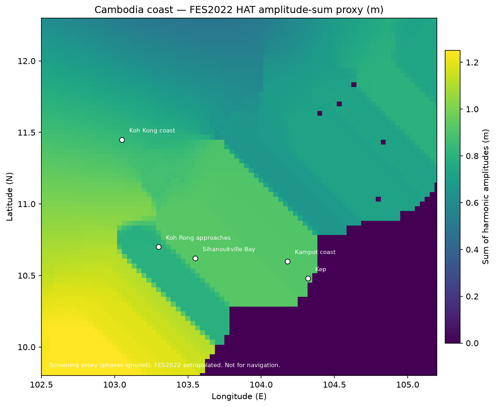
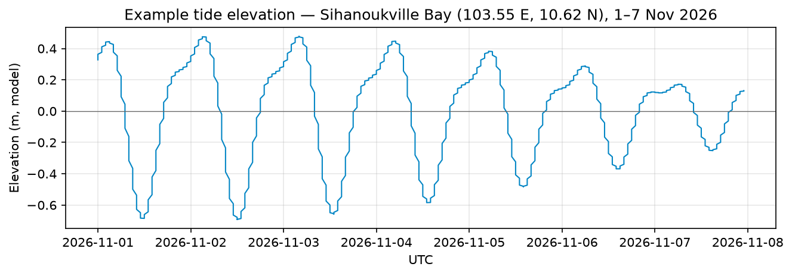

# L13 — FES2022 HAT examples and coastal map

**Status.** Raw FES2022 extrapolated heights were staged only until this step.
This note is the first processed product for the Note 3b elevation-check flag.

## Method

- Model: pyTMD `FES2022_extrapolated` (AVISO FES2022b ocean tide, heights only).
- **HAT amplitude-sum proxy:** sum of all 34 constituent amplitudes (metres).
  Conservative screening ceiling (assumes coincident peaks). Not a chart-datum HAT
  from an 18.6-year nodal prediction.
- **Mean spring range proxy:** `2 × (M2 + S2)` amplitudes.
- Box: W 102.5–E 105.2, S 9.8–N 12.3.
- Time series: eight major constituents (M2, S2, N2, K2, K1, O1, P1, Q1) reconstructed
  at Sihanoukville, 1–7 Nov 2026 UTC (illustrative; no nodal corrections).

## Example sites

| Site | Lon | Lat | M2 (m) | S2 (m) | K1 (m) | O1 (m) | Spring range 2(M2+S2) (m) | HAT amp-sum proxy (m) |
| --- | ---: | ---: | ---: | ---: | ---: | ---: | ---: | ---: |
| Koh Kong coast (Peam Krasop area) | 103.05 | 11.45 | 0.118 | 0.060 | 0.353 | 0.221 | 0.357 | 1.034 |
| Sihanoukville Bay | 103.55 | 10.62 | 0.110 | 0.050 | 0.233 | 0.177 | 0.319 | 0.797 |
| Kep | 104.32 | 10.48 | 0.099 | 0.011 | 0.194 | 0.141 | 0.221 | 0.720 |
| Koh Rong approaches | 103.30 | 10.70 | 0.109 | 0.051 | 0.247 | 0.186 | 0.321 | 0.829 |
| Kampot coast | 104.18 | 10.60 | 0.084 | 0.012 | 0.196 | 0.143 | 0.193 | 0.701 |

Grid HAT proxy range in box: **0.00–1.26 m** (median 0.73 m).

## Figures

## Files

- `inputs/screen-layers/L13/hat_amplitude_sum_proxy_kh.tif`
- `inputs/screen-layers/L13/visualizations/hat_proxy_map.png`
- `inputs/screen-layers/L13/visualizations/examples_timeseries.png`

## Next for the screen

Elevation-check flag (23 Nov 2026): `inputs/screen-layers/L13/elevation_check_flag_10m.tif`
and `inputs/screen-layers/L13/visualizations/l13-elevation-check.md` (`E_L12` = 0.74 m).
Optionally replace the amplitude-sum proxy with a true multi-year predicted HAT if CI
wants chart-style values.

