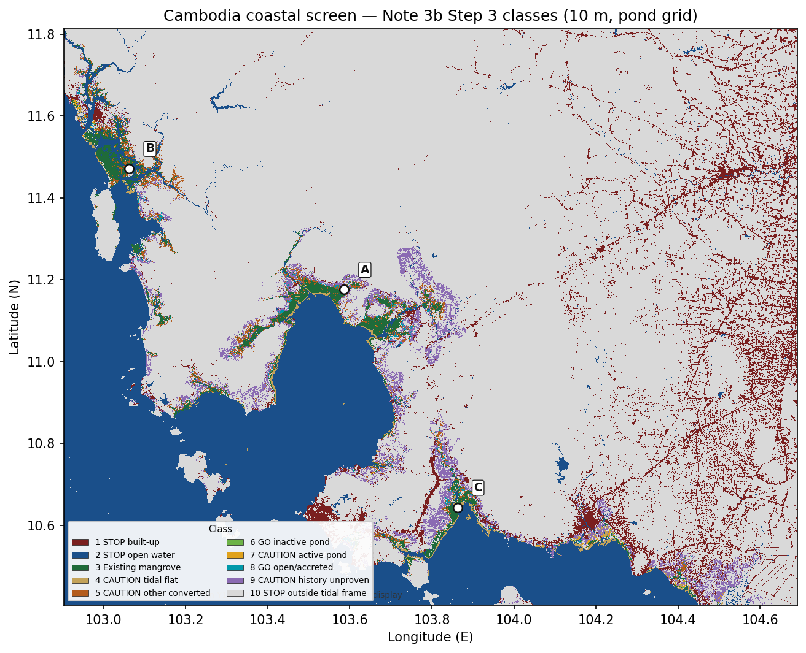
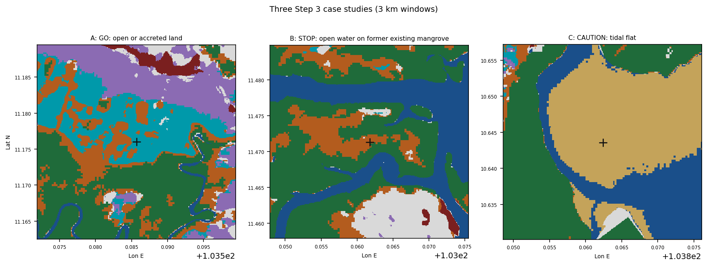
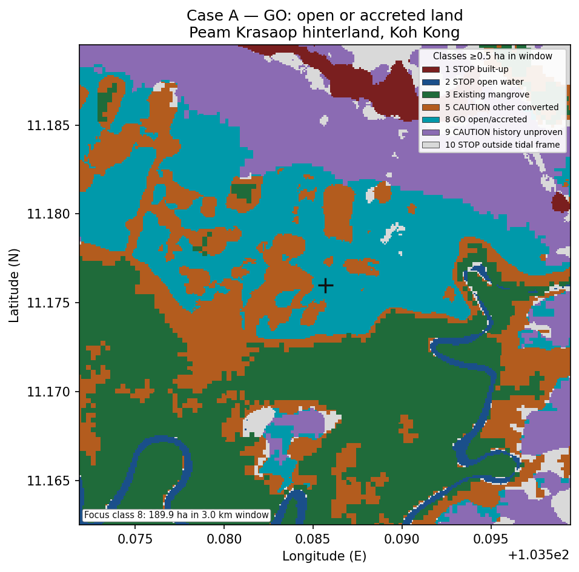
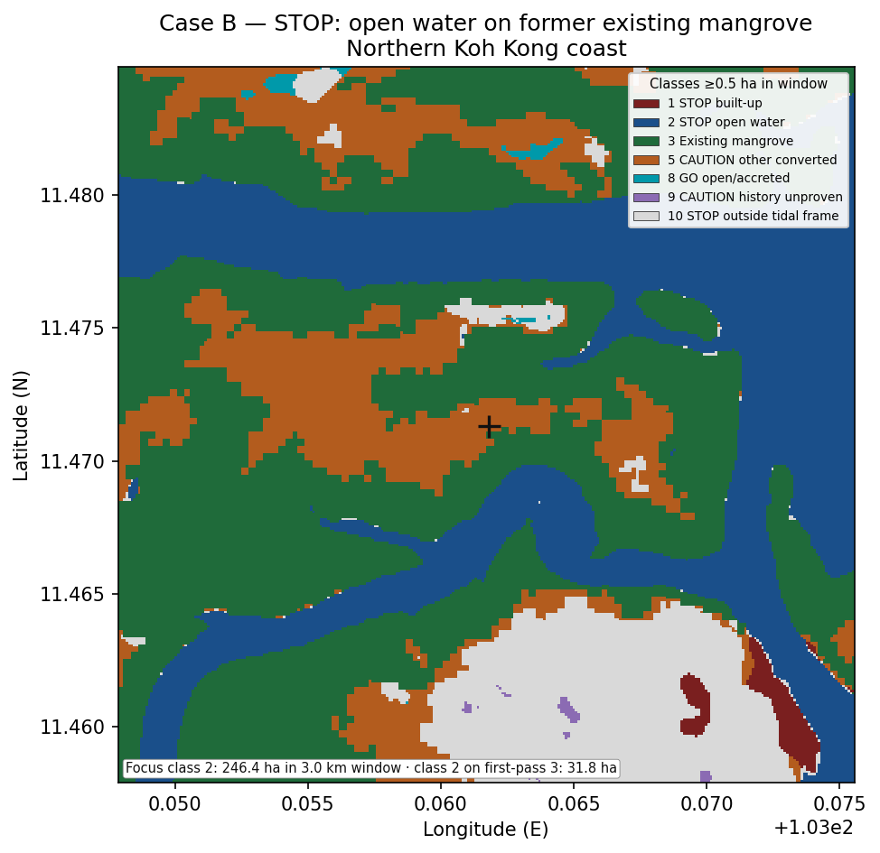
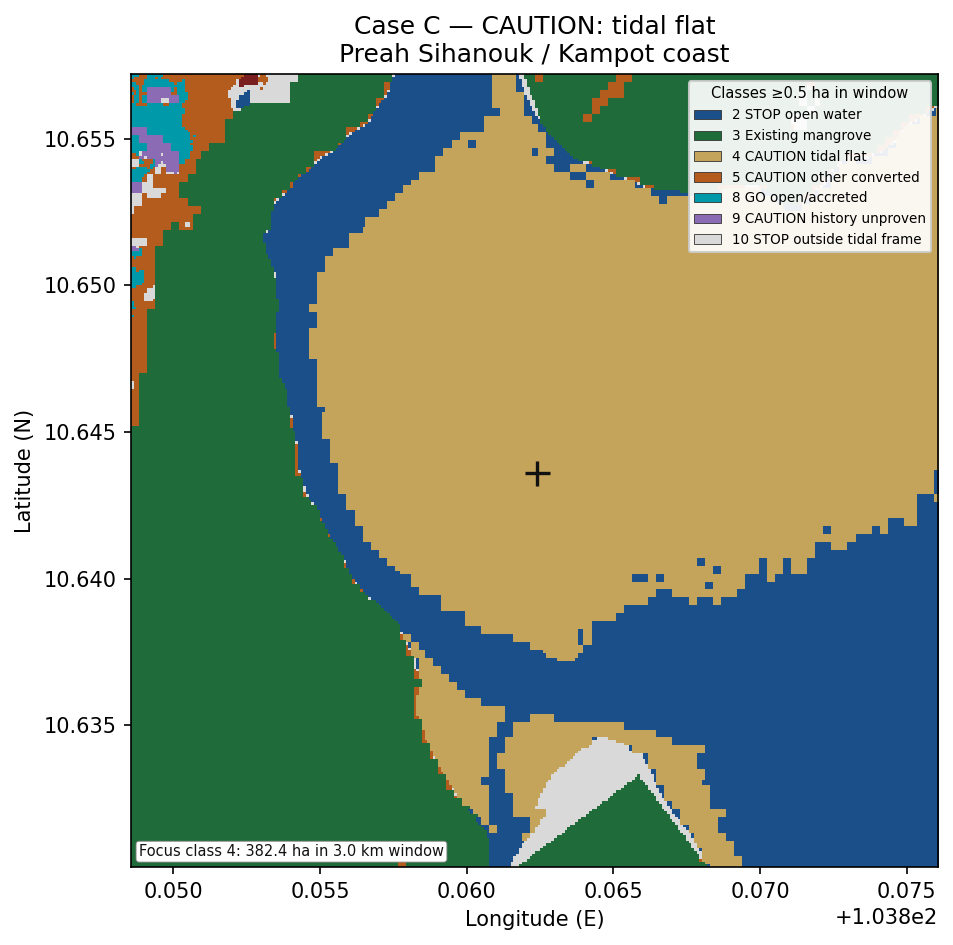

# How to read the Cambodia Step 3 screen (QGIS)

**INTERNAL.** Same story as [docs/03-restoration-screen.md](../../docs/03-restoration-screen.md); this page is the GIS walkthrough.

## Before you open the map

1. Confirm layers exist (see [LAYER-PATHS.md](LAYER-PATHS.md)). On a thin clone, skip to [Cases via PNGs](#cases-via-pngs).
2. Remember: **GO ≠ approval.** Class is physical / land-cover suitability only. Legal / tenure flags are incomplete; elevation-check is a separate flag.

## Open in QGIS

1. Start QGIS 3.28 or later.
2. Project → Open → `outputs/qgis-bridge/cambodia-screen-phase0.qgs` (paths are relative to the Cambodia repo root).
3. Expected layers (top → bottom):
   - **Cases A–C** (`cases.geojson`) — points
   - **Coastal four provinces** (`L20/coastal-four-provinces.geojson`)
   - **WDPA KHM** (if present) — polygons, 50% opacity
   - **Elevation-check flag** — single-band discrete (0 / 1 / 255)
   - **Class Step 3** — ten discrete classes
4. CRS: project is **EPSG:32648** (UTM 48N) to match the 10 m class grid. Case points are WGS84; QGIS reprojects on the fly.
5. If a layer is missing (yellow triangle), fix the path or stage the file — do not push rasters to a public remote.

### Manual add (no project file)

| Layer | Path from repo root | Type |
| --- | --- | --- |
| Class Step 3 | `inputs/screen-layers/L_class_10m/class_step3.tif` | Raster |
| Elevation-check flag | `inputs/screen-layers/L13/elevation_check_flag_10m.tif` | Raster |
| WDPA (merged) | `inputs/screen-layers/L17/WDPA_KHM_polygons_merged_INTERNAL.gpkg` layer `wdpa_khm` | Vector |
| Coastal provinces | `inputs/screen-layers/L20/coastal-four-provinces.geojson` | Vector |
| Cases A–C | `outputs/qgis-bridge/cases.geojson` | Vector |

Apply `styles/class_step3.qml` and `styles/elevation_check_flag.qml` after adding rasters.

## Class legend (first-match order)

| Code | Label | Colour (pack style) |
| ---: | --- | --- |
| 1 | STOP: built-up | `#7A1F1F` |
| 2 | STOP: open water | `#1A4F8A` |
| 3 | Existing mangrove (conserve) | `#1F6B3A` |
| 4 | CAUTION: tidal flat | `#C4A35A` |
| 5 | CAUTION: other converted | `#B35C1E` |
| 6 | GO: inactive pond | `#6DB347` |
| 7 | CAUTION: active pond | `#E0A21B` |
| 8 | GO: open or accreted land | `#0099AA` |
| 9 | CAUTION: history unproven | `#8B6BB3` |
| 10 | STOP: outside tidal frame | `#D9D9D9` |

Elevation-check flag: **0** within allowance, **1** caution (read GO inactive pond as caution when flagged), **255** not tested. Does not change the class code.

## Cases via PNGs

If rasters are not staged, open these figures (pack copies):





Hectare tables: [visualizations/step3-case-studies.md](visualizations/step3-case-studies.md).

### Case A — Why is this GO?

**Place.** Peam Krasaop hinterland, Koh Kong (103.5857 E, 11.1760 N).  
**Focus.** Class 8 GO open/accreted (~190 ha in a 3 km window).



Historic mangrove where Dynamic World now reads bare / grass / shrub. Candidate for a field look after elevation + permit checks — not a project yet.

### Case B — Why did conserve become STOP?

**Place.** Northern Koh Kong coast (103.0618 E, 11.4713 N).  
**Focus.** Class 2 STOP open water (~246 ha); includes first-pass mangrove overridden to water.



Class 2 sits above class 3 in rule order: permanent water is not a restoration site on this screen.

### Case C — Why is bare coast only CAUTION?

**Place.** Preah Sihanouk / Kampot coast (103.8624 E, 10.6436 N).  
**Focus.** Class 4 CAUTION tidal flat (~382 ha).



Murray intertidal flat → not GO. Hydrology / recruitment first; do not reclass silently to class 8.

## What the three cases teach

| Question | Case | Answer |
| --- | --- | --- |
| Where might restoration be worth scoping? | A | Class 8 (and elsewhere class 6) |
| When does the map overturn “existing mangrove”? | B | Class 2 above class 3 |
| When is open coast not GO? | C | Class 4 flats stay CAUTION |

## Zip for INTERNAL CI relay

From repo root (exclude FLAG rasters unless the recipient already has them offline):

```bash
# Pack docs + PNGs + project only (safe for INTERNAL relay of this folder)
zip -r cambodia-qgis-bridge-phase0.zip outputs/qgis-bridge \
  -x '*.tif' '*.tiff' '*.gpkg' '*.zip'
```

On a **full workstation**, give CI GIS the zip **plus** a private path or drive share to the three heavy layers — do not publish those to GitHub.
