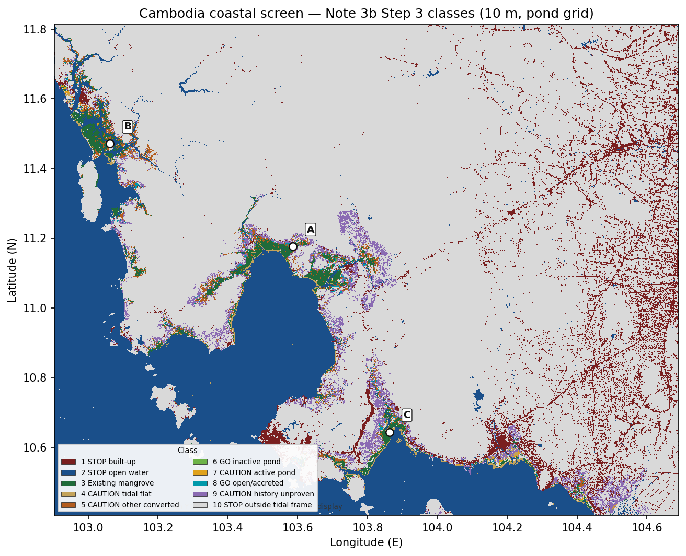
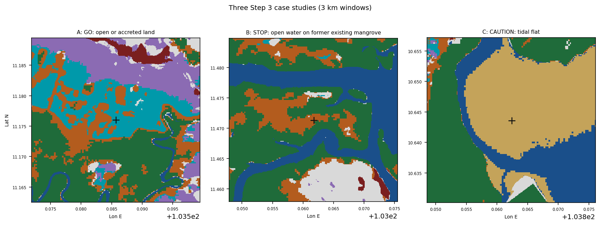
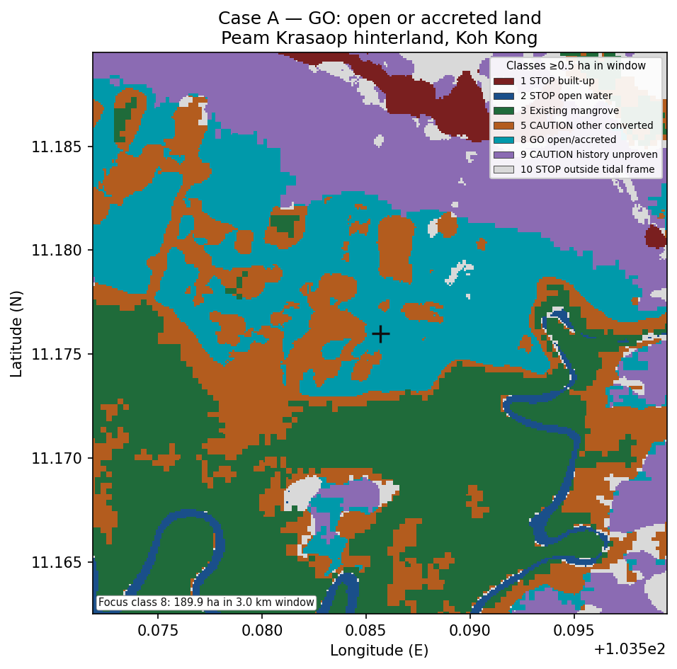
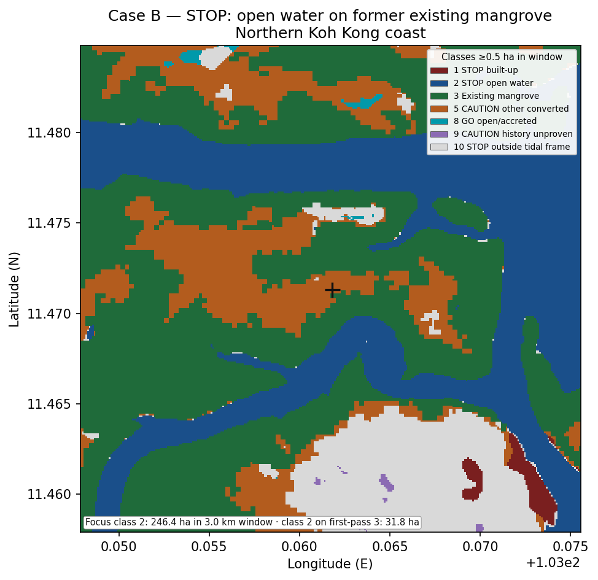
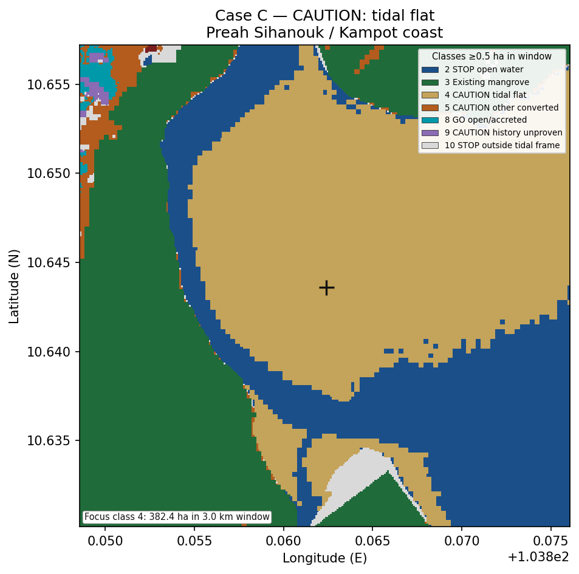

# Step 3 class maps and three case studies (figures)

**Pack copy** for Phase 0 QGIS bridge. Canonical tables live at `inputs/screen-layers/L_class_10m/visualizations/step3-case-studies.md`.  
**Narrative:** [../HOW-TO.md](../HOW-TO.md) and [docs/03-restoration-screen.md](../../../docs/03-restoration-screen.md).

Grid: `class_step3.tif` (EPSG:32648, 10 m). Y1/Y2 = 2024 and 2025.

## National overview

Sites A–C are marked. Class 10 (outside the tidal frame) fills most of the province
rectangle and is light grey so coastal classes stay readable.

## Three case studies

### Case A — GO: open or accreted land

**Place.** Peam Krasaop hinterland, Koh Kong (103.5857 E, 11.1760 N).
**Focus.** Class 8: 189.9 ha inside a 3.0 km window.

| Class | ha |
| ---: | ---: |
| 1 | 24.84 |
| 2 | 19.77 |
| 3 | 268.02 |
| 5 | 170.82 |
| 8 | 189.93 |
| 9 | 183.17 |
| 10 | 43.45 |

### Case B — STOP: open water on former existing mangrove

**Place.** Northern Koh Kong coast (103.0618 E, 11.4713 N).
**Focus.** Class 2: 246.4 ha inside a 3.0 km window. First-pass class 3 reassigned to class 2: 31.8 ha in this window (1,144 ha nationally).

| Class | ha |
| ---: | ---: |
| 1 | 8.03 |
| 2 | 246.37 |
| 3 | 406.20 |
| 5 | 139.01 |
| 8 | 2.49 |
| 9 | 1.26 |
| 10 | 96.64 |

### Case C — CAUTION: tidal flat

**Place.** Preah Sihanouk / Kampot coast (103.8624 E, 10.6436 N).
**Focus.** Class 4: 382.4 ha inside a 3.0 km window.

| Class | ha |
| ---: | ---: |
| 1 | 0.27 |
| 2 | 195.39 |
| 3 | 282.43 |
| 4 | 382.42 |
| 5 | 17.23 |
| 8 | 4.99 |
| 9 | 2.25 |
| 10 | 15.02 |

## QA cross-links

- National class ha and first-pass overrides: [../class_step3_qa.md](../../../inputs/screen-layers/L_class_10m/class_step3_qa.md)
- Map script: [../../../../intermediate/screen-build/process_step3_case_study_maps.py](../../../intermediate/screen-build/process_step3_case_study_maps.py)
