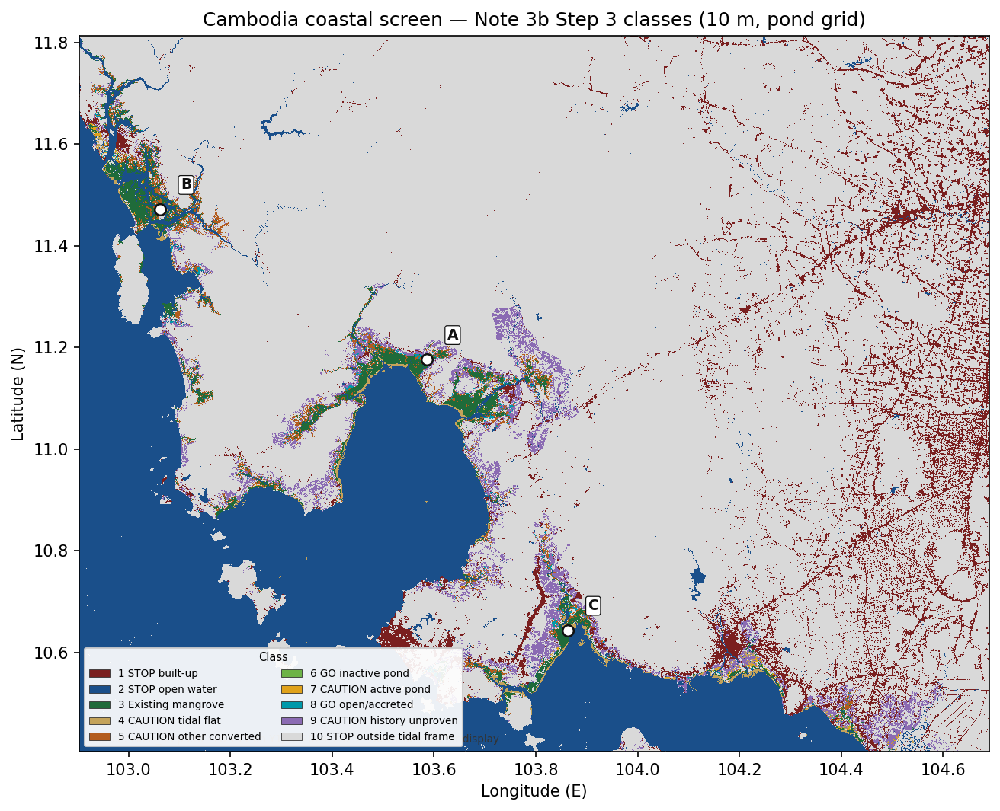
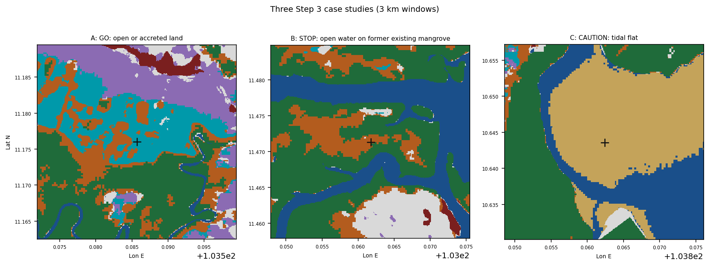
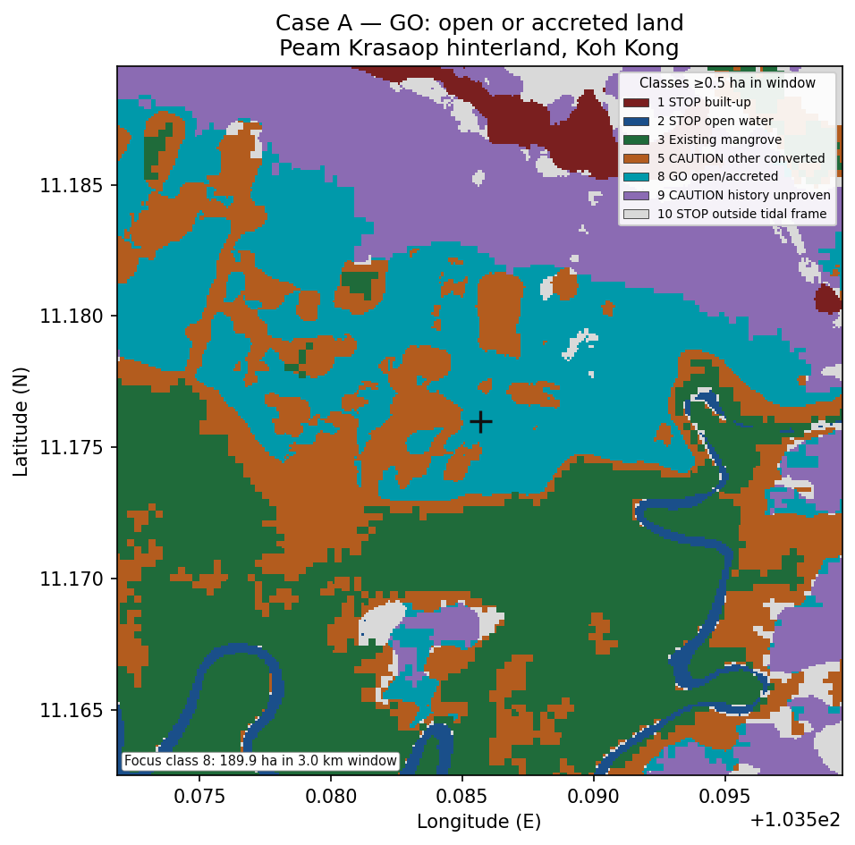
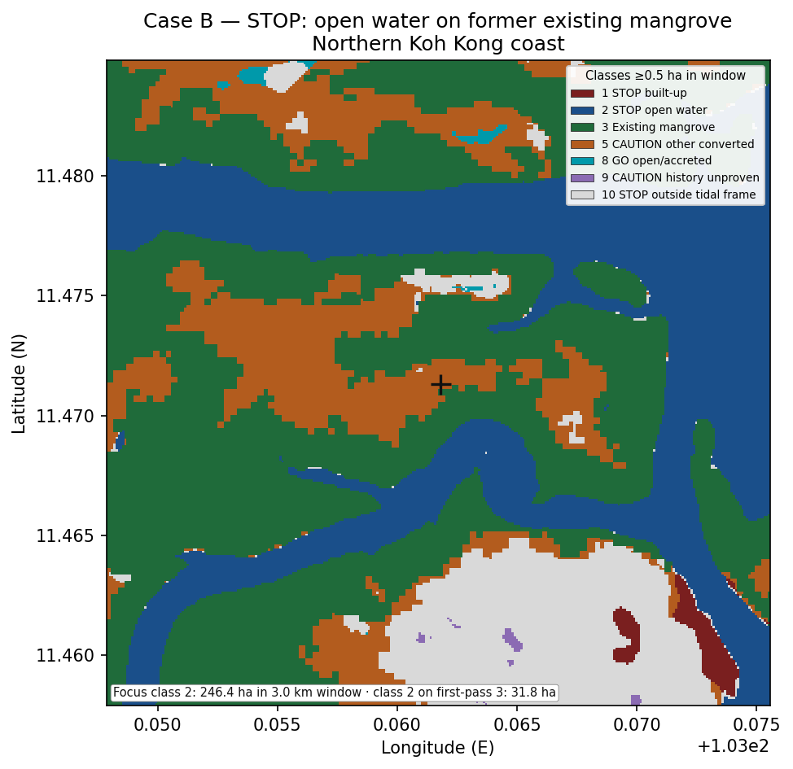
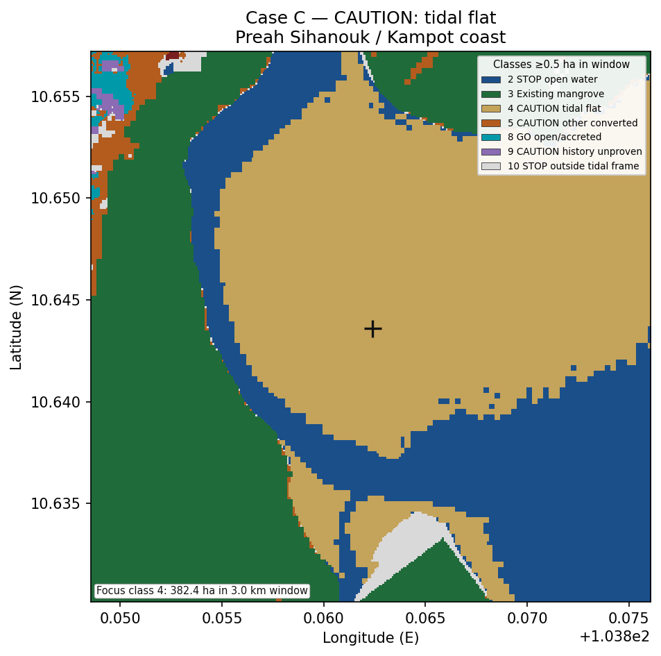

# Assembled draft for red team — Cambodia product docs (post-fix refresh)
Source files concatenated below. Refreshed after round-1 revise fixes.


---
## SOURCE FILE: README.md

# Cambodia blue carbon — Seed Fund, REDD+ and restoration screen

Internal working package for CI Cambodia: programme and REDD+ scoping notes, a project-selection framework, and a four-province coastal mangrove restoration-potential screen (land-cover and permit eligibility filter; proxy for restoration potential) built from open and restricted-licence (FLAG) data. Engaged under Services Agreement 6012328, Amendment 002, Deliverable 11, task **T3** (verbal commissioning only; see Open gates).

This folder is the package root. Documentation links inside it are relative and survive a move. Data (~13 GB under `inputs/screen-layers/`), beads tracker, host claim rules and contract PDFs are **not** self-contained; see [docs/07-migration.md](docs/07-migration.md).

**Plan of record:** [prd-cambodia-blue-carbon-seed-fund-scoping.md](prd-cambodia-blue-carbon-seed-fund-scoping.md)  
**Contract stub:** [CONTRACT.md](CONTRACT.md)  
**Package docs:** [docs/](docs/README.md)  
**Beads:** parent `CI_Blue_Carbon_ASEAN-ywdp`; screen build `CI_Blue_Carbon_ASEAN-ywdp.8`; docs pack closed `CI_Blue_Carbon_ASEAN-ie5t`; docs red team `CI_Blue_Carbon_ASEAN-fet9`  
**Red team (docs):** [red-team/cambodia-product-docs-red-team-2026-11-23.md](red-team/cambodia-product-docs-red-team-2026-11-23.md) (verdict: revise; fixes applied once)

## Open gates

- No commissioning email on file. No CI-facing send of the notes until Jordan internal sign-off **and** email confirmation of scope and days.
- Note tasks: verbal allocation "at least 3 days per note-task" (floor, not a ceiling; at least 9 across three). Screen-build days are **unconfirmed** under that verbal deal.
- Screen outputs that include FLAG inputs stay INTERNAL until the licence register is cleared for the intended use (research, CI relay, grant-funded build, or credit design each differ).

## Status (23 Nov 2026)

Single status table for the package. Modules link here; they do not restate it. Live lock detail: [intermediate/screen-build/SESSION-LOCK.md](intermediate/screen-build/SESSION-LOCK.md).

| Module | Status | Entry |
| --- | --- | --- |
| Policy notes (1, 2, 3, 3b) | Four notes in `outputs/`; consistency pass done; awaiting Jordan internal sign-off. Nothing sent to CI. | [outputs/README.md](outputs/README.md) · [docs/02-policy-notes.md](docs/02-policy-notes.md) |
| Restoration-potential screen | Phase 0 staged (L19 digital GIS closed). Steps 1–3 closed: class raster at `inputs/screen-layers/L_class_10m/class_step3.tif`. Elevation-check closed. How-to-read and cases A–C in the screen module. **No active claim.** Next open: permit / STOP (legal) flags using L17 (and related). No final map published. | [docs/03-restoration-screen.md](docs/03-restoration-screen.md) |
| Data and licences | Living register; FLAG rows. `inputs/screen-layers/` ≈ **13 GB** on disk (23 Nov 2026). | [docs/04-data-and-licences.md](docs/04-data-and-licences.md) |
| Build pipeline | Scripts and session lock in `intermediate/screen-build/`. | [docs/05-build-pipeline.md](docs/05-build-pipeline.md) |

## Folder map

| Path | Role |
| --- | --- |
| [docs/](docs/) | Modular documentation (this pack) |
| [red-team/](red-team/) | Docs-pack red team (assembled draft, pack, note) |
| [prd-cambodia-blue-carbon-seed-fund-scoping.md](prd-cambodia-blue-carbon-seed-fund-scoping.md) | PRD / plan of record |
| [CONTRACT.md](CONTRACT.md) | Commissioning and day facts (migration stub) |
| [inputs/](inputs/) | Source PDFs, desk-checks, `screen-layers/` data (~13 GB) |
| [intermediate/](intermediate/) | Research, gates, discussion briefs; `screen-build/` scripts and registers |
| [outputs/](outputs/) | Four internal notes + cover README |

Standard deliverable subfolders (`RAG/`, `visualizations/`, `archive/`) are created only when a file needs them.

## Audience and sensitivity

Primary reader of the notes is Jordan Gacutan (working material). Content is relayed to CI Cambodia and CI Blue Climate, not forwarded verbatim. Build on CI Cambodia's June 2026 report; do not correct it in tone. Government ownership and split jurisdiction apply (working assumption from that report: mangroves in protected areas with MoE; ARR outside them with the General Directorate of Fisheries (GDF), formerly the Fisheries Administration (FiA), under MAFF). Full rules: PRD §2.0 and [docs/01-overview.md](docs/01-overview.md).

## Quick links

- Reading order for the four notes: [outputs/README.md](outputs/README.md)
- Screen method (Note 3b): [outputs/03b-restoration-potential-screen-method.md](outputs/03b-restoration-potential-screen-method.md)
- How to read the screen (cases A–C): [docs/03-restoration-screen.md](docs/03-restoration-screen.md)
- Licence register: [intermediate/screen-build/phase-0-licence-register.md](intermediate/screen-build/phase-0-licence-register.md)
- Session lock (screen build): [intermediate/screen-build/SESSION-LOCK.md](intermediate/screen-build/SESSION-LOCK.md)
- Adjacent Cambodia artifact outside this tree (MoE roadmap letter): [docs/06-related-artifacts.md](docs/06-related-artifacts.md)
- How to migrate this package: [docs/07-migration.md](docs/07-migration.md)

## Host context (while nested in CI Engagement)

While this folder lives under `CI Contract 2/D11 - Additional Associated Tasks/`, the D11 README and the engagement root README point here. Those pointers, the host beads prefix, and `.cursor/rules/beads-claim-blocks-sessions.mdc` are host glue. They break or must be rewritten on a move. See [docs/07-migration.md](docs/07-migration.md).


---
## SOURCE FILE: CONTRACT.md

# Contract basis — Cambodia package (T3)

Living stub for migration and cold sessions. Host of record while nested: CI Engagement, Services Agreement 6012328, Amendment 002, Deliverable 11.

| Fact | Value |
| --- | --- |
| Agreement | Services Agreement 6012328 |
| Amendment | 002 (Attachment 1 governs Phase 2 scope) |
| Deliverable | 11 (additional associated tasks) |
| Task label | T3 — Cambodia blue carbon seed grant and REDD+ scoping |
| Commissioning | Verbal with CI Cambodia by 20 Nov 2026; **no commissioning email on file** |
| Day allocation (notes) | Verbal floor: at least 3 days per note-task (at least 9 across three). Not a ceiling. |
| Day allocation (screen) | **Unconfirmed** under that verbal deal |
| Acceptance | D11 Attachment 1 criteria only (no T3-specific wording) |
| CI-facing send | Blocked until Jordan internal sign-off **and** email confirmation of scope and days |
| Contacts (relay) | CI Cambodia: Sony Oum, Sey Peou. CI Blue Climate: Fiona Cromarty (Emily Pidgeon, Florence Laloë in copy as needed) |

Open gates and status: [README.md](README.md). Plan of record: [prd-cambodia-blue-carbon-seed-fund-scoping.md](prd-cambodia-blue-carbon-seed-fund-scoping.md).

**Before any move out of CI Engagement:** confirm confidentiality / IP with CI; keep this file; see [docs/07-migration.md](docs/07-migration.md).


---
## SOURCE FILE: docs/README.md

# Cambodia package docs

Documentation for the Cambodia blue carbon package (Seed Fund scoping, REDD+ two tracks, project selection, restoration-potential screen). Seven modules under one index.

**Do not read a module in isolation for build or release decisions.** Dependency order:

1. [01-overview.md](01-overview.md) (always)
2. The module you need
3. Before any screen edit: [../intermediate/screen-build/SESSION-LOCK.md](../intermediate/screen-build/SESSION-LOCK.md) and [04-data-and-licences.md](04-data-and-licences.md)
4. Method changes: [../outputs/03b-restoration-potential-screen-method.md](../outputs/03b-restoration-potential-screen-method.md) (or a dated addendum), not docs alone

Status lives in [../README.md](../README.md) only. After a folder move, links **inside** this tree keep working; host links and data handling are in [07-migration.md](07-migration.md).

## Modules

| # | Module | Use when you need… | Hard prerequisites |
| --- | --- | --- | --- |
| 01 | [Overview](01-overview.md) | Purpose, audience, contract basis, open gates, out of bounds | none |
| 02 | [Policy notes](02-policy-notes.md) | Notes 1 / 2 / 3 / 3b reading order, gates, sign-off | 01 |
| 03 | [Restoration screen](03-restoration-screen.md) | Spatial filter; **how to read the map** (user-guide start); cases A–C; classes, flags, SEEA framing | 01; Note 3b for full rules |
| 04 | [Data and licences](04-data-and-licences.md) | Staging paths, FLAG rules, register pointer | 01; living licence register |
| 05 | [Build pipeline](05-build-pipeline.md) | Scripts, phases, session lock, how to extend a step | 01, 04, SESSION-LOCK |
| 06 | [Related artifacts](06-related-artifacts.md) | Adjacent Cambodia work that is not inside this tree | 01 |
| 07 | [Migration](07-migration.md) | Cut list, what lifts, what stays, post-move checklist | 01, 04 |

## Package root

- [../README.md](../README.md) — entry point and **only** status table
- [../prd-cambodia-blue-carbon-seed-fund-scoping.md](../prd-cambodia-blue-carbon-seed-fund-scoping.md) — plan of record
- [../outputs/README.md](../outputs/README.md) — note cover sheet
- [../red-team/cambodia-product-docs-red-team-2026-11-23.md](../red-team/cambodia-product-docs-red-team-2026-11-23.md) — docs red team


---
## SOURCE FILE: docs/01-overview.md

# Overview — Cambodia blue carbon package

Prerequisites: none. Status: see [../README.md](../README.md) only.

## What this package is

Four internal scoping notes plus a four-province coastal mangrove restoration-potential screen (land-cover and permit eligibility filter; a **proxy** for restoration potential, not a hydrology or carbon model) for Cambodia's Country Package under the CI-hosted Seed Fund for Country Packages for Forests, Nature and Climate. The notes equip calls with CI Cambodia and CI Blue Climate. The screen is the first pre-feasibility filter described in Note 3 / Note 3b.

It is not a compiled SEEA EA or ocean account, not a carbon-credit project design, and not a CI-facing Word package until Jordan signs off, email confirms scope and days, and CI commissions that form.

## Why it exists

Cambodia's Country Package is in Design phase. Phase 1 (2026–2027) funds scoping work areas; Phase 2 names "vital reserves of high biodiversity and irrecoverable carbon" among grant areas. No Seed Fund page yet names blue carbon. CI Cambodia asked for help to:

1. place a blue carbon component in the package and say what Phase 1 scoping contains;
2. take a firm, sequenced position on blue carbon in Cambodia's REDD+ architecture (building on the June 2026 CI Cambodia report);
3. screen and select candidate projects, including a restoration-potential screen the seed grant could fund.

## Contract basis (host)

- **Agreement:** Services Agreement 6012328, Amendment 002, Deliverable 11 (additional associated tasks).
- **Task label:** T3 inside the host D11 folder.
- **Commissioning:** verbal with CI Cambodia by 20 Nov 2026; **no commissioning email on file**.
- **Day allocation:** verbal "at least 3 days per note-task" (floor, not a ceiling; at least 9 across three). Screen-build days are **unconfirmed**.
- **Acceptance:** D11 criteria in Attachment 1 (agreed before start; take CI feedback; complete required components). No T3-specific wording exists to quote.

### Open gates

- No CI-facing send until Jordan internal sign-off and email confirmation of scope and days.
- Do not treat further screen spend as funded until days for the screen are confirmed in writing.

If this tree leaves the CI Engagement host, write those facts into a local `CONTRACT.md` **before** the move; see [07-migration.md](07-migration.md).

## Audience

| Role | How they use it |
| --- | --- |
| Jordan Gacutan (primary) | Working notes: frank about gaps and overreach |
| CI Cambodia (Sony Oum, Sey Peou) | Relayed content, not raw files by default |
| CI Blue Climate (Fiona Cromarty; Emily Pidgeon, Florence Laloë in copy as needed) | Relayed |
| IBCI (Siti Maryam Yaakub) | Relayed where relevant |

## Sensitivities (short)

- Build on the June 2026 CI Cambodia report; credit by page; do not "correct" it in tone.
- Country Packages are country-led; frame CI as support to MoE DCC and Department of Biodiversity.
- Split jurisdiction (working assumption from that report, not re-checked against statute in this docs pack): mangroves in protected areas (MoE); ARR outside them (General Directorate of Fisheries (GDF), formerly the Fisheries Administration (FiA), under MAFF).
- Out of bounds for this package: ASEAN / D5, Singapore MSE, COP31 roles.

Full text: [../prd-cambodia-blue-carbon-seed-fund-scoping.md](../prd-cambodia-blue-carbon-seed-fund-scoping.md) §2.0–3.0.

## Doc modules (seven)

| Module | Docs | Working paths |
| --- | --- | --- |
| Policy notes | [02-policy-notes.md](02-policy-notes.md) | `../outputs/` |
| Restoration screen | [03-restoration-screen.md](03-restoration-screen.md) | Note 3b, `../inputs/screen-layers/`, `../intermediate/screen-build/` |
| Data and licences | [04-data-and-licences.md](04-data-and-licences.md) | licence register under `screen-build/` |
| Build pipeline | [05-build-pipeline.md](05-build-pipeline.md) | scripts under `screen-build/` |
| Related artifacts | [06-related-artifacts.md](06-related-artifacts.md) | host paths outside this tree |
| Migration | [07-migration.md](07-migration.md) | cut list |


---
## SOURCE FILE: docs/02-policy-notes.md

# Module — Policy notes

Prerequisites: [01-overview.md](01-overview.md). Status: [../README.md](../README.md).

Four internal Markdown notes. Cover sheet and reading order: [../outputs/README.md](../outputs/README.md). Plan: [../prd-cambodia-blue-carbon-seed-fund-scoping.md](../prd-cambodia-blue-carbon-seed-fund-scoping.md).

## Deliverables

| Note | File | Job |
| --- | --- | --- |
| 1 | [../outputs/01-seed-fund-country-package-blue-carbon.md](../outputs/01-seed-fund-country-package-blue-carbon.md) | Seed Fund programme; where Cambodia's package stands; blue carbon entry points |
| 2 | [../outputs/02-blue-carbon-in-redd-plus-two-tracks.md](../outputs/02-blue-carbon-in-redd-plus-two-tracks.md) | Track A (mangroves in REDD+) and Track B (seagrass / non-forest wetlands); builds on CI Cambodia June 2026 report |
| 3 | [../outputs/03-blue-carbon-project-selection-feasibility-framework.md](../outputs/03-blue-carbon-project-selection-feasibility-framework.md) | Selection gates and criteria; stylised archetypes only (no named site scored) |
| 3b | [../outputs/03b-restoration-potential-screen-method.md](../outputs/03b-restoration-potential-screen-method.md) | Method spec and data list for the screen (companion to Note 3; no map in the note) |

## Gates and close-out

Each note records its own verify pass, hostile red team and director gate. A cross-note consistency pass and set-level director gate are logged in [../intermediate/consistency-log.md](../intermediate/consistency-log.md).

**Sign-off path:** Jordan internal sign-off (PRD 9.0 step 5) before any CI send. No Word compile is planned until asked.

## Settled decisions

Do not relitigate without a new interview: [../intermediate/discussion-brief-cambodia-seed-fund-redd-scoping-2026-11-20.md](../intermediate/discussion-brief-cambodia-seed-fund-redd-scoping-2026-11-20.md).

## Research and gate working files

Under [../intermediate/](../intermediate/): `research-*.md`, `path-*-verify.md`, `path-*-red-team*.md`, discussion briefs. These are process artifacts; the product surface for readers is `outputs/`.

## Boundaries with the screen module

Note 3b specifies the screen. The build itself (rasters, scripts, QA) and the **how-to-read / worked examples** are the [restoration screen](03-restoration-screen.md) module; scripts and phases are [build pipeline](05-build-pipeline.md). Keep method changes in Note 3b (or a dated addendum); keep implementation notes in `intermediate/screen-build/`.


---
## SOURCE FILE: docs/03-restoration-screen.md

# Module — Restoration-potential screen

Prerequisites: [01-overview.md](01-overview.md); full rules in Note 3b. Status: [../README.md](../README.md).

Four-province coastal mangrove screen (Koh Kong, Preah Sihanouk, Kampot, Kep) at a 10 m analysis grid, built from open and restricted-licence (FLAG) data, with a restricted seagrass analogue. It is a **land-cover and permit eligibility filter** and a **proxy** for restoration potential: it does not test salinity, sediment supply, tenure willingness or carbon outcome. Method of record: [../outputs/03b-restoration-potential-screen-method.md](../outputs/03b-restoration-potential-screen-method.md).

This module is also the start of the **user guide** for reading the class map. Method numbers stay in Note 3b; build steps stay in [05-build-pipeline.md](05-build-pipeline.md). What follows is how to interpret a cell once the map is open.

## What it produces

- Class raster (ten classes: GO / CAUTION / STOP as **physical / land-cover suitability**, not legal clearance or tenure). Current file: [../inputs/screen-layers/L_class_10m/class_step3.tif](../inputs/screen-layers/L_class_10m/class_step3.tif). No class implies planting permission.
- Five flags (attach without changing class): permit gate; STOP (legal); project overlap; elevation check; small (under 100 ha contiguous). Elevation-check is on disk; permit / STOP (legal) / project-overlap are not yet burned into the class codes.
- Class areas and loss-year structure. **SEEA EA extent inputs (proposal):** class 3 (opening mangrove stock) and historic-loss / conversion readings called out in Note 3b §1.1. GO / CAUTION / STOP partitions are **not** ecosystem extent and must not be added to stock. A SEEA or ocean-accounts table is a **separate derivation**, not a by-product of the class raster. The screen itself is **not** a compiled account.

Extent: Koh Kong, Preah Sihanouk, Kampot, Kep; land under ~10 m elevation inside the habitat mask; sea to ~10 m depth for the seagrass analogue only. Minimum mapping unit 0.5 ha (applied in Step 1 H/C; Step 3 does not re-sieve).

## How to read the map

1. Open the class raster (or the overview PNG below). Colour is the **first matching** Note 3b rule, not a soft blend of layers.
2. Ask what the cell was historically (`H` = mangrove in the 1996 baseline or three consecutive years from 1996) and what it is now (Dynamic World over calendar 2024 and 2025, plus pond and flat layers).
3. Treat GO as "worth a field look" (physical suitability only; legal status unverified), CAUTION as "needs a named check before planting or claiming restoration", and STOP as "do not treat as a restoration site on this screen". Never read GO as MoE or CI zoning approval.
4. Read flags next to the class. A GO cell can still fail the elevation check or sit inside a core zone once those overlays are applied.
5. Do not treat class 10 (outside the tidal frame) as a surveyed finding. On the present pond-grid rectangle it is the residual: everything that matched no earlier rule, including inland province.

Four-province overview with the three worked examples marked A–C:



Hectare tables and zoom figures for the same sites: [../inputs/screen-layers/L_class_10m/visualizations/step3-case-studies.md](../inputs/screen-layers/L_class_10m/visualizations/step3-case-studies.md). Full screen QA (four-province extent): [../inputs/screen-layers/L_class_10m/class_step3_qa.md](../inputs/screen-layers/L_class_10m/class_step3_qa.md).

## Class order (summary)

Full rules and anchors are in Note 3b §4. Order of first match:

1. STOP: built-up  
2. STOP: open water  
3. Existing mangrove: conserve  
4. CAUTION: tidal flat  
5. CAUTION: other converted  
6. GO: inactive pond  
7. CAUTION: active pond  
8. GO: open or accreted land  
9. CAUTION: history unproven  
10. STOP: outside tidal frame  

Classes 3, 5 (salt only), 6 and 7 were assigned on a first pass from mangrove and pond layers. Classes 1 and 2 may replace those where they match. Class 4 does not replace them; overlap is counted in the QA and left as the earlier class.

## Worked examples (user guide)

Three sites, chosen because each answers a different question a reader will ask of the map. Windows are 3 km across. Strip view:



### Case A — Why is this GO?

**Place.** Peam Krasaop hinterland, Koh Kong (103.5857 E, 11.1760 N).  
**Class in focus.** 8 GO: open or accreted land (190 ha in the window).



**Narrative.** The window sits behind the Peam Krasaop mangrove front. Existing mangrove (class 3) still holds the wetter and more canalised ground. Inland of that fringe, large teal patches are class 8: the cell was historic mangrove, and Dynamic World now calls it bare, grass or shrub rather than trees, crops, water or built-up. Orange patches are class 5 (mostly trees outside current mangrove), and purple is class 9 (inside the habitat mask without a proven historic record under the H rule).

**Rationale.** Note 3b follows the open and accreted classes used in Indonesian restoration screening: where mangrove history is established and the cover is open, the site is a restoration candidate, not a conserve site and not a pond. The map therefore marks GO so Phase 1 scoping can put eyes on it. It is not yet a project. Before any planting claim, run the elevation-check flag (L12 vs L13) and the permit overlays; class 8 next to class 5 or 9 in the same window is a reminder that neighbouring cells failed a different test.

### Case B — Why did conserve become STOP?

**Place.** Northern Koh Kong coast (103.0618 E, 11.4713 N).  
**Class in focus.** 2 STOP: open water (246 ha in the window), including 32 ha that were first-pass existing mangrove (1,144 ha of that override across the screen extent).



**Narrative.** The first-pass map labelled much of this estuary as class 3 (current mangrove, conserve). After L8–L11, branching channels that Dynamic World sees as water in at least 90 percent of 2024–2025 observations flip to class 2, provided they are not a Murray tidal flat and not inside the Step 2 pond mask. Remaining green is mangrove that did not meet that water test. Brown is other converted use on historic mangrove.

**Rationale.** The open-water STOP exists so the screen does not propose restoration in permanent water. Because class 2 sits above class 3 in the rule order, a cell that is both "current mangrove in GMW" and "almost always water in Dynamic World" becomes STOP, not conserve. That is a deliberate product choice and a known tension: optical mangrove products and land-cover time series disagree on channel margins. Use Case B when explaining overrides of the first pass. Do not delete the screen-wide 1,144 ha from the conserve story without checking imagery; do not leave it as GO.

### Case C — Why is a bare coast only CAUTION?

**Place.** Preah Sihanouk / Kampot coast (103.8624 E, 10.6436 N).  
**Class in focus.** 4 CAUTION: tidal flat (382 ha in the window).



**Narrative.** A broad tan apron sits seaward of a green mangrove edge and beside deep blue open water. Murray Global Intertidal Change (latest epoch 2014–2016) marks those cells as tidal flat; Dynamic World now reads bare or water. The screen therefore refuses a GO label even though the surface looks "open" in the same sense as Case A.

**Rationale.** Global Mangrove Alliance tidal-frame guidance and Note 3b agree that mudflats are not planting ground: hydrology and natural recruitment come first. Class 4 is CAUTION so a reader pauses for that check instead of counting the hectares as accreted land. Class 8 in Case A required historic mangrove *and* open cover *without* the flat label; Case C fails that path at the flat rule, which sits higher than class 8. If a later hydrology study clears a parcel, that is a project decision outside this screen, not a silent reclass to GO.

## What the three cases teach together

| Question | Case | Product answer |
| --- | --- | --- |
| Where might restoration be worth scoping? | A | Class 8 (and, elsewhere, class 6 inactive ponds) |
| When does the map overturn "existing mangrove"? | B | Class 2 above class 3 when water frequency is extreme |
| When is open coast not GO? | C | Class 4 flats stay CAUTION |

Built-up STOP (class 1) is not one of the three worked sites. It is the Dynamic World modal call; most of its screen-wide area is not corroborated by WorldCover class 50 or a GHS-BUILT-S 2025 fraction of 50 percent. Disagreement is stored on `built_disagree.tif` and does not change the class. Read that flag before treating class 1 as settled urban fabric.

## Data layout

| Path | Contents |
| --- | --- |
| [../inputs/screen-layers/](../inputs/screen-layers/) | Staged and derived layers (Note 3b IDs **L1–L21**; see [04-data-and-licences.md](04-data-and-licences.md) for staged vs GEE-only), ponds, class rasters, QA sidecars |
| [../inputs/screen-layers/L_class_10m/](../inputs/screen-layers/L_class_10m/) | `class_step3.tif`, QA, built-up disagreement flag |
| [../inputs/screen-layers/L_class_10m/visualizations/](../inputs/screen-layers/L_class_10m/visualizations/) | Overview and case-study PNGs (figures for this guide) |
| [../intermediate/screen-build/](../intermediate/screen-build/) | Fetch/process scripts, phase-0 registers, prompts, session lock |

Layer catalogue and licence flags: [04-data-and-licences.md](04-data-and-licences.md). Scripts and step order: [05-build-pipeline.md](05-build-pipeline.md).

## Build state

Do not restate status here. Use [../README.md](../README.md) and [../intermediate/screen-build/SESSION-LOCK.md](../intermediate/screen-build/SESSION-LOCK.md).

## Release constraints

Several inputs are FLAG (non-commercial, no redistribute, or permission required). Derivatives inherit FLAG restrictions. Do not publish a combined product, share commercially, or push FLAG layers to a public remote without clearing [04-data-and-licences.md](04-data-and-licences.md). Prefer publishing method + open-only derivatives, or an INTERNAL-only package. Overview and case PNGs in `visualizations/` stay INTERNAL until a release decision clears the licence-by-use path (research vs CI relay vs grant vs credit).


---
## SOURCE FILE: docs/04-data-and-licences.md

# Module — Data and licences

Prerequisites: [01-overview.md](01-overview.md); living register below. Status: [../README.md](../README.md).

Authoritative living register: [../intermediate/screen-build/phase-0-licence-register.md](../intermediate/screen-build/phase-0-licence-register.md).  
Click-list of download links: [../intermediate/screen-build/phase-0-downloads.md](../intermediate/screen-build/phase-0-downloads.md).  
Method table (IDs **L1–L21**): [../outputs/03b-restoration-potential-screen-method.md](../outputs/03b-restoration-potential-screen-method.md) §3.

This module does not duplicate the register. It states how to use it and where files live so a migrated tree remains operable.

## Staging root

`inputs/screen-layers/` held about **13 GB** on disk on 23 Nov 2026 (will grow). Layout:

```text
inputs/screen-layers/
  L1/ L2/ L3/ …          # upstream products (by Note 3b ID) when staged as files
  L_Jiang_ponds/         # alternate pond polygons
  L_Clark_aquaculture/   # Clark land-cover / change (FLAG)
  L_Peng/                # seagrass (Peng)
  L_ponds_10m/           # derived pond stack + QA
  L_mangrove_10m/        # Step 1 H/C + QA
  L_class_10m*/          # Step 3 class rasters + QA
  L8_L11_10m/            # GEE exports used in Step 3
```

**GEE-only / no staging folder (typical):** L6, L7, L9, L10, L11, L16 (and L21 as imagery labels only). Confirm against Note 3b §3 and the register before treating an ID as missing.

Keep new layers in a named subfolder with a short `PROVENANCE.txt` (URL, date, licence line, SHA if available). Point the licence register at that path.

## V / U / FLAG

| Mark | Meaning |
| --- | --- |
| V | Licence re-read at the source URL on the date in the register |
| U | Unconfirmed (do not treat as cleared) |
| FLAG | Redistribution or commercial use restricted |

**Inheritance.** Any raster, table or figure derived from a FLAG layer carries that restriction until cleared. "Open-only derivatives" means products built only from layers whose licences allow the intended release.

### Licence by use (short)

| Intended use | Rule |
| --- | --- |
| Internal research screen (this build) | FLAG layers OK only as the register allows for non-commercial research |
| Relay to CI Cambodia / CI Blue Climate | Clear FLAG rows for that share; prefer method + open-only tables; do not send FLAG geometries without clearance |
| Seed-grant / Phase 1 funded build | Re-check register; grant-funded work is not automatically "research" |
| Credit project design or revenue-linked screening | Different licence path (Note 3b §8); free Earth Engine tier excludes commercial work |

Earth Engine and Google Earth imagery have their own non-commercial / no-redistribute terms. Treat exports as INTERNAL unless the catalogue licence clearly allows the intended release.

FLAG examples to clear against the register before any share: Clark aquaculture (non-commercial rider), L15 UNEP-WCMC seagrass, L17 WDPA (research OK; commercial / revenue-linked restricted), L21 Google Earth labels.

## Known closed doors

- **L19 MoE Forest Cover 2018 digital GIS:** will not be provided (23 Nov 2026). Booklet PDF may remain as reference only. Do not chase NFMS as a substitute without a new decision.
- **L5 CAP (Mendeley):** 1° grids only in the download used; unusable for pond footprints. Jiang / Clark paths replace for Step 2.

## Migration note

On move: separate the git-tracked tree from the ~13 GB data. Options: disk/object storage + fetch scripts; or Git LFS on a **private** remote that may hold FLAG layers. Never push FLAG / INTERNAL layers to a public remote. See [07-migration.md](07-migration.md).


---
## SOURCE FILE: docs/05-build-pipeline.md

# Module — Build pipeline

Prerequisites: [01-overview.md](01-overview.md), [04-data-and-licences.md](04-data-and-licences.md), [../intermediate/screen-build/SESSION-LOCK.md](../intermediate/screen-build/SESSION-LOCK.md). Status: [../README.md](../README.md).

Implementation of Note 3b lives in [../intermediate/screen-build/](../intermediate/screen-build/). Scripts are local to that folder; outputs go to [../inputs/screen-layers/](../inputs/screen-layers/) (derived) or layer-specific `visualizations/`.

## Session discipline

Before editing screen scripts or class rasters:

1. Read [../intermediate/screen-build/SESSION-LOCK.md](../intermediate/screen-build/SESSION-LOCK.md).
2. Claim a beads issue (`bd update <id> --claim`). An `in_progress` claim blocks other sessions.
3. Leave progress on the issue with `bd update <id> --notes "…"`.

Host repo rule: `.cursor/rules/beads-claim-blocks-sessions.mdc` (rewrite or copy if this tree leaves CI Engagement).

## Next actions (plain)

As at SESSION-LOCK 23 Nov 2026 (confirm before starting):

1. Open a new beads issue under parent `CI_Blue_Carbon_ASEAN-ywdp.8` for permit and STOP (legal) flags using L17 (and related), then claim it.
2. Do not reopen closed Step 3 L8–L11 (`ywdp.8.6`) or elevation-check (`ywdp.8.5`) without a new decision.
3. Notes: Jordan internal sign-off on the four notes (parent `CI_Blue_Carbon_ASEAN-ywdp`) before any CI send.

## Script inventory (as staged)

| Script | Role |
| --- | --- |
| `fetch_l4_goldberg_khm.sh` | ORNL DAAC mangrove loss drivers (KHM) |
| `fetch_l13_fes2022_pytmd.py` / `fetch_l13_fes2022_curl_ftp.sh` | FES2022 tide heights |
| `fetch_l14_gebco_cambodia.py` | GEBCO coastal clip |
| `export_l8_l11_gee.py` | GEE export helper for built-up / intertidal family |
| `process_pond_layers_note3b.py` | Jiang + Clark → `L_ponds_10m` |
| `process_l6_pond_state_gee.py` | Wet / dry / intermittent pond state |
| `process_step1_mangrove_hc.py` | Historic / current mangrove |
| `process_step3_class_firstpass.py` | Early class mosaic |
| `process_step3_l8_l11.py` | Step 3 with L8/L11 inputs |
| `process_step3_case_study_maps.py` | Case-study / overview map figures for the user guide |
| `process_elevation_check_l12_l13.py` | Elevation vs tidal envelope check |
| `process_l13_hat_examples_map.py` | HAT example maps |

Also in the folder (not run scripts): `phase-0-*.md`, `prompt-*.md`, `websearch-*.md`, `SESSION-LOCK.md`. Re-list after adding files.

Prompts for parallel agent runs (`prompt-*.md`) sit beside the scripts. Prefer updating the prompt and the script together.

## Suggested phase order

Logical build order (not a live status table; see README + SESSION-LOCK):

| Phase | Intent | Primary docs |
| --- | --- | --- |
| 0 | Licence register + stage upstream layers | `phase-0-licence-register.md`, `phase-0-downloads.md` |
| 1 | Grid, habitat clip, mangrove H/C | `process_step1_mangrove_hc.py` |
| 2 | Ponds and water frequency | `process_pond_layers_note3b.py`, `process_l6_pond_state_gee.py` |
| 3 | Classification + flags | `process_step3_*.py` |
| 4 | Elevation / tidal checks, legal overlays | `process_elevation_check_*.py`, L17/L18 |
| 5 | QA, area tables, optional SEEA crosswalk export (separate derivation) | layer `*_qa.md` sidecars |

## Adding a step

1. Create or claim a beads issue; note the Note 3b section you implement.
2. Add `process_*.py` or `fetch_*.py` under `screen-build/` (no new top-level script dirs).
3. Write outputs only under `inputs/screen-layers/<layer>/` with QA markdown beside the raster.
4. Update the licence register if a new upstream product appears.
5. Update the status table in [../README.md](../README.md) when a phase completes (do not fork status into this module).

## Dependencies

Scripts assume a local Python with geospatial stack (GDAL/rasterio/geopandas as used per script), Earth Engine auth for GEE exports, and Homebrew paths where noted in script headers. Document any new binary dependency in the script docstring and here.


---
## SOURCE FILE: docs/06-related-artifacts.md

# Module — Related artifacts (outside this tree)

Prerequisites: [01-overview.md](01-overview.md). **Host paths below break on migration**; rewrite or copy the files into `related/` and update this module ([07-migration.md](07-migration.md)).

Cambodia work that is **not** inside the T3 product root. Listed so a migration can choose to bring them, leave a stub, or drop them.

## MoE blue carbon roadmap letter

| Item | Host path (while nested in CI Engagement) |
| --- | --- |
| Markdown source | `CI Contract 2/D11 - Additional Associated Tasks/intermediate/ci-letter-moe-cambodia-blue-carbon-roadmap.md` |
| DOCX output | `CI Contract 2/D11 - Additional Associated Tasks/outputs/ci-letter-moe-cambodia-blue-carbon-roadmap.docx` |
| Compile script | `CI Contract 2/D11 - Additional Associated Tasks/intermediate/compile_d11_cambodia_letter_docx.py` |

Predates the T3 folder convention; no commissioning email on file. Uses the CI template via the D6 speaker-request compile walk. **Optional cargo** on migration: copy into `related/moe-roadmap-letter/` under the new root, or leave in the host D11 audit trail.

## D6 Cambodia MoE panelist slide plan

| Item | Host path |
| --- | --- |
| Slide plan | `CI Contract 2/D6 - Pre-COP31 Negotiator Webinar/intermediate/slide-plan-cambodia-moe-panelist.md` |

COP31 webinar material. Out of bounds for T3 substance (PRD), but useful as audience context. Do not merge into the note set. Migration: leave in D6 unless a Cambodia umbrella repo explicitly wants a `related/` copy.

## CI Cambodia June 2026 policy/finance report

Staged text extract used by Notes 1–2:

- `../inputs/ci-cambodia-2026-policy-finance-report.txt`

That file **is** inside the product tree. Keep it on any move; Notes 2 page citations depend on it.

## Host D11 bookkeeping

Day allocation and commissioning status for T3 remain recorded in the host [D11 README](../../README.md) while nested. After migration, copy the T3 row into a local `CONTRACT.md` (see [07-migration.md](07-migration.md)).


---
## SOURCE FILE: docs/07-migration.md

# Module — Migration

Prerequisites: [01-overview.md](01-overview.md), [04-data-and-licences.md](04-data-and-licences.md).

How to lift this package out of CI Engagement (or any host) without breaking the documentation surface.

## What "self-contained" means here

**Docs links inside this tree** are relative and should keep working after a move.

**Not self-contained:** `inputs/screen-layers/` (~13 GB on 23 Nov 2026), host beads (`CI_Blue_Carbon_ASEAN-` prefix), `.cursor/rules/beads-claim-blocks-sessions.mdc`, contract PDFs, and host README pointers. Host paths inside [06-related-artifacts.md](06-related-artifacts.md) must be rewritten or inlined.

## Pre-move gates (do these first)

0. Read confidentiality and IP clauses of Services Agreement 6012328; record CI consent before the tree leaves the CI Engagement host (June 2026 report extract and any MoE-relayed content included).
1. Write `CONTRACT.md` at the new root **before** the move: agreement ID, D11/T3 basis, verbal day facts, open gates, contacts, date of move.
2. Decide data handling for ~13 GB and FLAG layers (private LFS, object storage, or disk-only). Never push FLAG / INTERNAL to a public remote.

## Cut list — documentation and code unit

```text
T3 - Cambodia blue carbon seed grant and REDD+ scoping/
  README.md
  docs/
  red-team/
  prd-cambodia-blue-carbon-seed-fund-scoping.md
  CONTRACT.md          # stub exists; refresh before move
  intermediate/        # scripts, research, gates (exclude huge accidental dumps)
  outputs/
```

### Data unit (separate decision)

```text
inputs/                # includes screen-layers/ ≈ 13 GB
```

Split if needed: re-fetchable upstream zips vs non-reproducible derived rasters vs FLAG. Keep QA markdown and `PROVENANCE.txt` with the git tree even if rasters stay out.

Suggested destination names (pick one):

- `Cambodia/` under an ASEAN or GOAP umbrella (mirror of how PHL sits under ASEAN engagement)
- Standalone private repo `cambodia-blue-carbon` / `cambodia-seed-fund-screen`

## Optional cargo (decide per move)

| Artifact | Default |
| --- | --- |
| MoE roadmap letter + compile script ([06-related-artifacts.md](06-related-artifacts.md)) | Leave in host D11, or copy to `related/moe-roadmap-letter/` |
| D6 MoE panelist slide plan | Leave in D6 |
| Host beads history for `ywdp*` | Export notes into a new tracker; do not assume Dolt remote sync |

## Do not move as Cambodia package

- Other D11 tasks (T1, T2)
- Contract PDFs and Amendment 002 (cite from host or summarise in `CONTRACT.md`)
- GOAP / CI Word templates used only for the letter compile
- ASEAN / D5 / COP31 deliverable folders

## Post-move checklist

1. Open [../README.md](../README.md) and confirm relative links resolve.
2. Walk [docs/README.md](README.md); rewrite host paths from [06-related-artifacts.md](06-related-artifacts.md).
3. Confirm `CONTRACT.md` is present and accurate.
4. Init or link a beads (or other) tracker; close or supersede host issues with a pointer to the new IDs.
5. Copy or rewrite session-lock and claim rules for the new repo.
6. Update host READMEs to a stub: "Cambodia package moved to \<path\> on \<date\>".
7. Update Documents / GitHub index READMEs if the umbrella index still points here.
8. Smoke-test one fetch or process script so paths in docstrings still match.
9. Confirm FLAG layers are absent from any public remote.

## Stub text for the host (after move)

```text
T3 Cambodia package moved on YYYY-MM-DD to <new-path>.
Package docs and working tree no longer live under CI Engagement.
```

## Modular growth after migration

Keep adding capability as new `docs/NN-*.md` modules and new folders under `inputs/` / `intermediate/` / `outputs/`. Do not fold unrelated country work into this root; start a sibling package instead.
